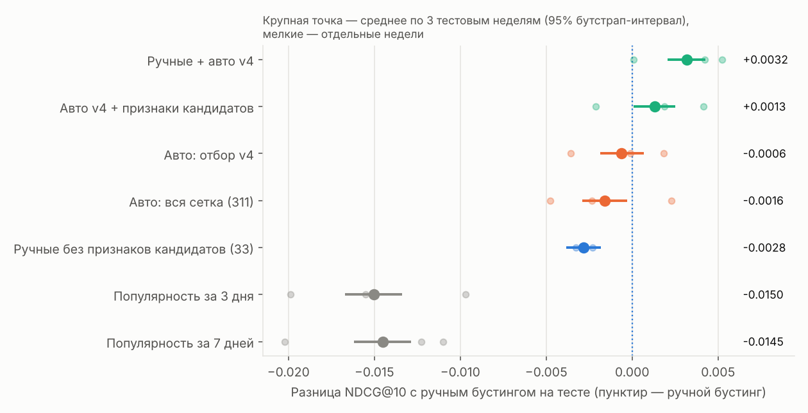
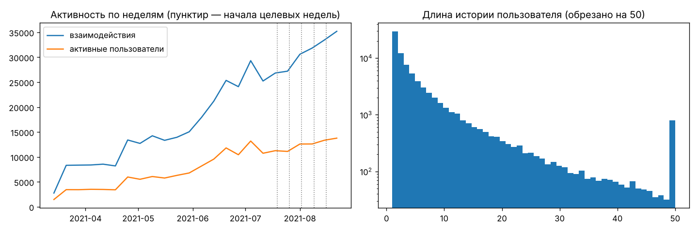
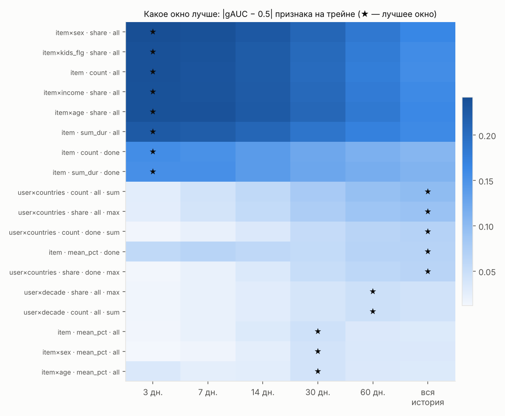
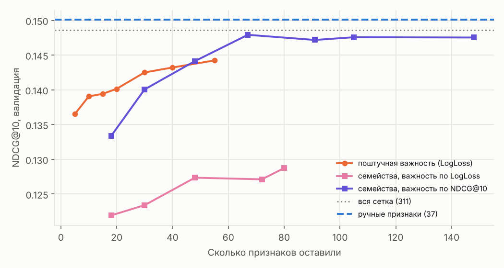
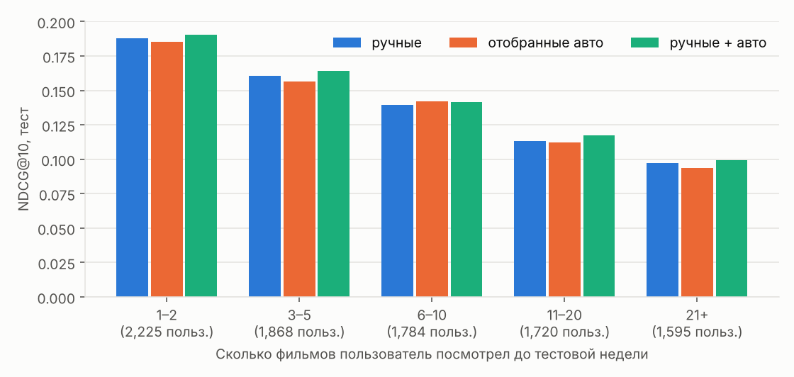

# Можно ли автоматизировать построение признаков для рекомендаций?

Тестовое задание T-Lab, направление «Рекомендательные системы», задача 1.

**Коротко.** На датасете KION я собрала пайплайн «кандидаты → бустинг» с 37 ручными
признаками и сравнила его с генератором признаков. Генератор перебирает декартово
произведение «сущность × агрегат × окно × тип события» (311 признаков, по сути
SQL-шаблонов `GROUP BY`), а затем автоматически отбирает признаки на валидации.

Итоговое сравнение сделано на **трёх тестовых неделях** (rolling evaluation, раздел 6):
на одной неделе разница между лучшими моделями оказалась меньше шума между неделями.

Главные выводы:

1. **Автоматически отобранные признаки поверх ручных устойчиво улучшают сильный
   бустинг.** Модель «ручные + авто (отбор v4)» лучше ручного бустинга на всех трёх
   неделях — и на валидации, и на тесте. В среднем по тесту NDCG@10 0.1523 против
   0.1491: **+0.0032**, 95% бутстрап-интервал [+0.0020; +0.0043], около +2%.
   Это же лучшая модель по средней валидации, то есть она выбрана без взгляда на тест.
2. **При одинаковой доступной информации автоматические признаки не хуже ручных.**
   Отобранные автопризнаки с теми же 4 признаками генератора кандидатов: +0.0013
   [+0.0001; +0.0025] к ручному бустингу; лучше на валидации во всех 3 неделях,
   на тесте — в 2 из 3. Человек задавал только словарь сущностей и операций,
   а не конкретные признаки.
3. **Что осталось за человеком — covisitation.** Связь item–item через пользователей
   не выражается шаблоном «один `GROUP BY`». Без неё ручной набор теряет 0.0028
   на тесте, а сами по себе автопризнаки (без covisitation) уступают ручным
   (с covisitation) лишь −0.0006 [−0.0019; +0.0007].
4. **Автоматический отбор легко сломать, и разбор этого — важная часть работы.**
   Первые три варианта отбора проиграли полной сетке. Причины: одномерный скрининг
   слеп к признакам пользователя, а важность по LogLoss обманывается нестационарностью
   счётчиков и выкидывает популярность фильма как «вредную». Исправленный отбор v4
   оставляет 60 признаков из 311 и лучше полной сетки на валидации во всех трёх
   неделях (на тесте — в двух из трёх).
5. **Перебор окон отвечает на вопрос «почему 7 дней».** Во всех трёх неделях
   самый важный автопризнак — популярность фильма за **3 дня** (в ручном наборе было
   7 и 30), а вкусы пользователя лучше описываются длинными окнами (60 дней или вся
   история).



---

## 1. Задача и данные

**Датасет:** [KION от МТС](https://github.com/irsafilo/KION_DATASET) — 5,5 млн просмотров
962 тысяч пользователей, 15,7 тысяч фильмов и сериалов, 13.03.2021 – 22.08.2021.
Одна строка — пара (user, item) с датой последнего просмотра, длительностью `total_dur`
и процентом просмотра `watched_pct`. Есть демография пользователей (возраст, доход,
пол, наличие детей) и метаданные фильмов (жанры, страны, режиссёры, студии, год, рейтинг).

**Сэмпл:** 80 000 случайных пользователей **со всей их историей** — 455 тысяч
взаимодействий, 9,6 тысяч фильмов. Сэмплируются именно пользователи, а не строки,
иначе признаки «что пользователь смотрел раньше» потеряли бы смысл.

> ⚠️ Файл `interactions.csv.zip` в корне репозитория KION обрезан (1,6 млн строк
> из 5,5 млн). Полная таблица лежит внутри `data_en.zip` — её и использует
> `scripts/00_download_data.sh`.

**Постановка:** для пользователя в момент начала недели предсказать, какие фильмы
он начнёт смотреть в течение следующих 7 дней. Таргет `label = 1`, если пара
(user, item) появилась в целевой неделе. Это та же постановка, что в соревновании
по KION (там метрика MAP@10).

Особенность KION: на пару user–item одна строка, повторных просмотров «новой строкой»
нет. Поэтому уже просмотренные фильмы исключаются из кандидатов — они не могут
стать позитивом.

> ⚠️ **Важное следствие формата данных.** В строке хранится дата *последнего* просмотра.
> Если пользователь начал сериал до целевой недели и продолжил смотреть в ней, строка
> целиком попадает в целевую неделю: в истории её нет, а в таргете она становится
> «новым» позитивом. Значит, состав истории зависит от будущего, и в продакшене
> такой просмотр был бы виден заранее. Тест на утечки (ниже) это не ловит:
> он портит только будущие строки, а здесь будущее влияет на то, *каких строк нет*
> в прошлом. Эффект одинаков для всех недель и всех моделей, поэтому сравнение
> подходов остаётся честным, но абсолютные значения метрик стоит читать с этой поправкой.



## 2. Схема эксперимента

### Разбиение по времени

```
           история (признаки и кандидаты)                 │ целевая неделя (только таргет)
───────────────────────────────────────────────────────── │ ───────────────
train   13.03 ……………………………………………………………… 18.07          │ 19.07 – 25.07
train   13.03 ……………………………………………………………… 25.07          │ 26.07 – 01.08
train   13.03 ……………………………………………………………… 01.08          │ 02.08 – 08.08
valid   13.03 ……………………………………………………………… 08.08          │ 09.08 – 15.08
test    13.03 ……………………………………………………………… 15.08          │ 16.08 – 22.08
```

Это **фолд 0**. Для итоговой оценки (раздел 6) то же разбиение повторено ещё дважды
со сдвигом на 1 и 2 недели назад:

| Фолд | train (целевые недели) | valid | test |
|---|---|---|---|
| 0 | 19.07, 26.07, 02.08 | 09.08 | 16.08 |
| 1 | 12.07, 19.07, 26.07 | 02.08 | 09.08 |
| 2 | 05.07, 12.07, 19.07 | 26.07 | 02.08 |

В каждом фолде отбор признаков и ранняя остановка делаются заново, только на его
train и valid.

* Для каждой целевой недели признаки и кандидаты считаются **только по событиям
  строго до её начала**. История теста включает валидационную неделю: в момент
  предсказания эти данные уже были бы доступны.
* Оцениваются «тёплые» пользователи — те, у кого есть история и кто что-то посмотрел
  в целевой неделе (≈ 9 тысяч пользователей на неделю). Холодный старт — отдельная задача.
* Все решения внутри одного подхода (ранняя остановка бустинга, отбор признаков,
  выбор числа признаков) принимаются только на валидации, тест в них не участвует.
* **Финальная модель выбирается по средней валидации на трёх фолдах.** Тестовые
  метрики приведены для всех моделей ради прозрачности, но выбирать «лучшую» по ним
  нельзя: максимум из многих тестовых чисел — это уже подгонка под тест.
* **Честное замечание о порядке работы.** Работа шла итеративно. Сначала на фолде 0
  были сделаны варианты отбора v1–v3 (раздел 5); v2, v3 и затем v4 я придумывала,
  уже посмотрев на результаты предыдущих, включая тест фолда 0. Поэтому тест фолда 0
  для v4 не полностью «чистый». Тестовые недели фолдов 1 и 2 раньше использовались
  только как train/valid, на них итоговые модели как на тесте не оценивались, —
  это более независимая проверка, и выводы на них совпадают.

### Кандидаты (одинаковые для всех моделей)

Три источника, все считаются по истории:

| Источник | Что это |
|---|---|
| `popular` | топ-50 по числу просмотров за последние 14 дней |
| `genre` | топ-15 за 30 дней в каждом из двух самых частых жанров пользователя |
| `covisit` | топ-40 фильмов, которые чаще всего смотрят вместе с тремя последними просмотрами пользователя |

В среднем ≈ 70 кандидатов на пользователя; в них попадает **31–35% реальных
просмотров** целевой недели. Это верхняя граница Recall для любого ранжировщика.

### Модель и метрики

* **Модель:** `HistGradientBoostingClassifier` из scikit-learn — гистограммный бустинг
  по тому же алгоритму, что LightGBM (бинаризация признаков, рост деревьев по листьям).
  Он ставится вместе с scikit-learn и не требует отдельной зависимости; переход на
  LightGBM меняет одну функцию в `src/model.py`. Гиперпараметры одинаковы для всех наборов признаков —
  сравниваем признаки, а не тюнинг. Ранняя остановка по валидационной неделе
  (поэтому метрики на валидации немного оптимистичны; это одинаково для всех моделей,
  так что сравнивать их по валидации корректно).
* **Трейн:** три недели; оставлены пользователи с хотя бы одним позитивом среди
  кандидатов, из негативов — случайные 30%. Валидация и тест не прореживаются.
* **Ранжирующие метрики:** NDCG@10, Recall@10, MAP@10 — по **всем** реальным просмотрам
  тёплых пользователей, а не только по попавшим в кандидаты.
* **Классификационные:** ROC-AUC и LogLoss по строкам кандидатов.
* **Значимость:** парный бутстрап по пользователям тестовых недель (2000 повторов;
  перевыборка внутри каждой недели отдельно). Бутстрап не учитывает разброс между
  неделями, поэтому вторая, более строгая проверка — совпадает ли знак разницы
  на всех трёх неделях.

### Как проверено отсутствие утечек

`tests/test_no_leakage.py` берёт неделю и **портит все события начиная с её начала**:
перемешивает фильмы, подменяет проценты и длительности, добавляет мусорные события.
Затем всё строится заново, и проверяется, что все 37 ручных и 311 автоматических
признаков на общих парах не изменились. Меняться имеет право только таргет.

Тест сразу нашёл реальную проблему: дубли пар в таргете размножали строки
кандидатов, и суммирующие признаки удваивались. Исправлено `drop_duplicates`
в `src/candidates.py` (на настоящем KION пары уникальны, но код не должен на это полагаться).

## 3. Бейзлайн: бустинг на ручных признаках

37 признаков, придуманных «руками» (`src/features_manual.py`):

| Группа | Признаки |
|---|---|
| Пользователь | демография; число просмотров за 7 / 30 дней и всего; длительность за 30 дней; средний % просмотра; доля сериалов; средний год выпуска; дней с первого и последнего просмотра |
| Фильм | популярность за 7 / 30 дней и всего; тренд 7/30; средний % просмотра за 30 дней; дней с первого и последнего просмотра; год, возрастной рейтинг, «детский», сериал или фильм |
| Пара: косвенные связи | доля жанров, стран, режиссёров фильма в истории пользователя (среднее и максимум); популярность фильма в возрастной группе пользователя; разница года выпуска с «типичным» для пользователя; совпадение типа контента |
| Кандидаты | из каких источников пришёл кандидат; covisitation-скор |

| Модель | NDCG@10 valid | NDCG@10 test | Recall@10 test | MAP@10 test | ROC-AUC test |
|---|---|---|---|---|---|
| Популярность за 7 дней | 0.1320 | 0.1323 | 0.2071 | 0.0884 | — |
| Бустинг на ручных признаках | **0.1501** | **0.1433** | **0.2137** | **0.0989** | 0.7703 |

Бустинг уверенно обходит популярность: +0.011 NDCG@10, бутстрап-интервал
[+0.008; +0.014]. Разрыв небольшой, и это типично для KION: просмотры сильно
сконцентрированы в популярных новинках, и популярность — очень сильный бейзлайн.
С результатами соревнования по KION напрямую сравнивать нельзя: там другой
протокол (все пользователи, включая холодных, и закрытая неделя), а здесь сэмпл.

## 4. Исследовательская часть: генератор признаков + автоматический отбор

### Идея

Почти любой признак из таблицы выше — это SQL-запрос одного шаблона:

```sql
SELECT <ключ>, <агрегат>(<поле>)
FROM events [JOIN items / users]
WHERE date >= :week_start - <окно> AND date < :week_start AND <фильтр события>
GROUP BY <ключ>
```

с последующим присоединением к парам (user, item). Значит, признак полностью
описывается несколькими параметрами, и пространство признаков можно **перебирать
систематически**, а не придумывать по одному. Человек задаёт только «словарь»:
какие есть сущности и операции. Какие окна и связи полезны, решает отбор на данных.

### Пространство признаков (`src/features_auto.py`)

Признак — это `FeatureSpec(entity, agg, window, event, reduce)`:

| Параметр | Значения |
|---|---|
| `entity` | `user`, `item`, **`user×<атрибут фильма>`** для 7 атрибутов (жанры, страны, режиссёры, студии, тип контента, десятилетие, возрастной рейтинг) — косвенные связи; **`item×<сегмент пользователя>`** для 4 сегментов (возраст, доход, пол, дети) |
| `window` | 3, 7, 14, 30, 60 дней и вся история |
| `event` | все просмотры / только досмотренные (`watched_pct ≥ 80`) — аналог типов событий «показ / клик / покупка» |
| `agg` | `count`, `sum_dur`, `mean_pct`, `share` (доля внутри пользователя или сегмента), `ratio` (конверсия в досмотр), `days_since_last` |
| `reduce` | как свернуть, если у фильма несколько значений атрибута: `sum` / `max` / `min` |

Декартово произведение даёт **311 признаков**. У каждого есть читаемое имя
(`a__user_x_genres__share__30d__all__max`) и SQL-описание `FeatureSpec.to_sql()`;
SQL отобранных признаков лежит в `reports/selection/selected_features.csv`.

### Отбор (`src/selection.py`)

Ниже — исходная схема (вариант v1). Итоговый вариант v4 отличается в двух местах,
см. конец раздела 5.3. Три ступени, от дешёвой к дорогой:

1. **Скрининг на трейне.** Для каждого признака считается grouped AUC: насколько он
   *сам по себе* ранжирует кандидатов внутри одного пользователя. Модель не нужна,
   это занимает секунды. Признаки с |gAUC − 0.5| < 0.005 отбрасываются.
2. **Удаление дублей.** Идём от сильных признаков к слабым и не берём признак, если
   его ранговая корреляция с уже взятым больше 0.97 (например, «просмотры за 30 и 60
   дней» у редко заходящих пользователей почти совпадают).
3. **Отбор по модели на валидации.** Обучаем бустинг на оставшемся, считаем
   permutation importance (рост LogLoss на валидации), затем обучаем модели на
   топ-N признаках для разных N и выбираем N по NDCG@10 на валидации.

Отбор пришлось переделывать четыре раза: первые варианты сломались, и разбор причин —
одна из главных частей работы (раздел 5.3).

## 5. Первая итерация: одна неделя (фолд 0)

Этот раздел — исследовательская часть на одном разбиении: абляции сетки, выбор окон
и три варианта отбора. Итоговое сравнение на трёх неделях — в разделе 6.

Все модели — один и тот же бустинг с одинаковыми гиперпараметрами, одни и те же
недели и кандидаты. Модели упорядочены по NDCG@10 на **валидации**. Δ — разница NDCG@10 с ручным бустингом на тесте,
в скобках — 95% интервал парного бутстрапа по пользователям тестовой недели.

| Модель | Признаков | NDCG@10 valid ↓ | NDCG@10 test | Recall@10 test | MAP@10 test | Δ NDCG@10 test |
|---|---|---|---|---|---|---|
| **Ручные признаки** | 37 | **0.1501** | 0.1433 | 0.2137 | 0.0989 | — |
| Ручные + авто v2 | 117 | 0.1489 | 0.1431 | 0.2135 | 0.0985 | −0.0002 [−0.0019; +0.0014] |
| Ручные + авто v3 | 104 | 0.1489 | 0.1396 | 0.2113 | 0.0952 | −0.0037 [−0.0058; −0.0017] |
| Ручные + авто v1 | 92 | 0.1487 | 0.1461 | 0.2188 | 0.1010 | +0.0028 [+0.0009; +0.0049] |
| Авто: вся сетка | 311 | 0.1486 | 0.1385 | 0.2090 | 0.0946 | −0.0048 [−0.0069; −0.0026] |
| Авто: семейства, важность по NDCG (v3) | 67 | 0.1479 | 0.1379 | 0.2077 | 0.0946 | −0.0053 [−0.0075; −0.0033] |
| Ручные без признаков кандидатов | 33 | 0.1468 | 0.1410 | 0.2127 | 0.0967 | −0.0023 [−0.0040; −0.0007] |
| Авто v1 + признаки кандидатов | 59 | 0.1464 | 0.1442 | 0.2177 | 0.0988 | +0.0009 [−0.0014; +0.0031] |
| Авто: поштучный отбор (v1) | 55 | 0.1442 | 0.1416 | 0.2129 | 0.0974 | −0.0017 [−0.0042; +0.0006] |
| Популярность за 7 дней | — | 0.1320 | 0.1323 | 0.2071 | 0.0884 | −0.0110 [−0.0139; −0.0082] |
| Авто: семейства, важность по LogLoss (v2) | 80 | 0.1287 | 0.1258 | 0.1869 | 0.0870 | −0.0175 [−0.0202; −0.0146] |

Полная таблица с ROC-AUC, LogLoss и временем: `reports/results_table.csv`.

**Как читать таблицу.** На этой неделе по валидации лучший — ручной бустинг:
добавление автопризнаков v1–v3 к ручным на валидации ничего не даёт (0.1487–0.1489
против 0.1501). На тесте у «ручные + авто v1» лучшее число (0.1461), но выбирать
модель по тесту нельзя: из 11 вариантов какой-то обязательно окажется выше
бейзлайна случайно. Этот результат и привёл к двум следующим шагам: к исправлению
отбора (v4) и к оценке на нескольких неделях (раздел 6).

> **Важная оговорка про шум.** Бутстрап по пользователям учитывает только случайность
> выбора пользователей внутри тестовой недели. Разница между неделями заметно больше:
> порядок моделей на валидации и на тесте часто не совпадает. Например, «ручные + авто v3»
> на валидации на уровне лучших (0.1489), а на тесте −0.0037. Поэтому разницы меньше
> ~0.004 на одной неделе я считаю неразличимыми. Кроме того, валидационные числа
> немного оптимистичны: по этой же неделе делалась ранняя остановка и отбор признаков.
> Поэтому итоговые выводы сделаны по трём неделям (раздел 6).

### 5.1. Абляции сетки: какие части генератора нужны

Модель на подмножествах из 311 признаков, без отбора:

| Что оставили | Признаков | NDCG@10 valid | NDCG@10 test |
|---|---|---|---|
| Вся сетка | 311 | 0.1486 | 0.1385 |
| Только `user` и `item` (без косвенных связей) | 88 | 0.1377 | 0.1346 |
| Без `item×сегмент` | 263 | 0.1449 | 0.1379 |
| Только окна 7 / 30 дней и вся история | 161 | 0.1457 | 0.1417 |
| Только «все просмотры», без досмотренных | 189 | 0.1470 | 0.1371 |

* **Косвенные связи — главный источник качества генератора.** Без `user×атрибут`
  и `item×сегмент` качество падает почти до уровня популярности.
* **Популярность внутри сегмента** (`item×возраст`, `item×пол` и т.д.) полезна:
  без неё −0.004 на валидации.
* **Фильтр «досмотренные»** (аналог разных типов событий) даёт прирост на валидации.
* **Больше окон — не значит лучше.** Сетка с тремя окнами на валидации чуть хуже полной, а на тесте даже лучше.
  Лишние почти одинаковые признаки дают бустингу больше возможностей переобучиться
  на шум конкретных недель. Отсюда и нужен отбор.

### 5.2. Какие окна лучше

Для каждого «семейства» (один и тот же признак с разными окнами) — насколько хорошо
признак сам по себе ранжирует кандидатов внутри пользователя (|gAUC − 0.5| на трейне):



Картина чёткая и интерпретируемая:

* **Популярность фильма — чем короче окно, тем лучше:** 3 дня > 7 > 14 > 30 > 60 > вся
  история. Каталог KION живёт новинками, и вчерашний спрос предсказывает завтрашний
  лучше месячного. В ручном бейзлайне были 7 и 30 дней.
* **Вкусы пользователя (страны, десятилетия выпуска фильмов) — наоборот, длинное окно**
  (60 дней или вся история): история у большинства пользователей короткая
  (медиана — 2 фильма), и короткие окна у них просто пустые.
* **Средний процент досмотра** — промежуточный случай: лучше всего 30 дней.

Перебор дёшево отвечает на вопрос «почему 7, а не 10?»: скрининг 311 признаков
занимает около минуты.

**Но это одномерная сила признака, а не прирост модели.** Абляция в 5.1 говорит
обратное: сетка только с окнами 7 / 30 дней и всей историей на тесте лучше полной
(0.1417 против 0.1385), а на валидации чуть хуже (0.1457 против 0.1486).
Бустинг, у которого есть популярность за 7 дней, сам «восстанавливает» почти всю
информацию из окна в 3 дня. Поэтому вывод аккуратный: окна, которые выбирает перебор,
содержательно правдоподобны, но доказательства, что они лучше ручных для модели, нет.

### 5.3. Как ломается автоматический отбор (и как это починить)



**v1. Поштучный отбор** (скрининг → удаление дублей → permutation importance по LogLoss
→ выбор числа признаков). Оставил 55 признаков, но на валидации он *хуже всей сетки*
(0.1442 против 0.1486), и кривая ещё растёт на последней точке. Две причины:

* **ошибка в дизайне скрининга:** grouped AUC слеп к признакам пользователя. Внутри
  одного пользователя они константны, и их одномерный gAUC почти ровно 0.5. Поэтому
  все `user`-признаки отсеялись на первом шаге, хотя в сочетании с признаками фильма
  они полезны. Это нужно было предусмотреть заранее: признаки, константные внутри
  группы, нельзя оценивать внутригрупповой метрикой;
* у коррелирующих признаков (одно и то же за 7 и 14 дней) поштучная permutation
  importance занижена: модель берёт информацию из соседа.

**v2. Отбор семействами, важность по LogLoss.** Перемешиваем сразу все окна
одного семейства. Результат — **катастрофа**: 0.1287 на валидации, хуже популярности.
Семейство `item|count` (популярность фильма) получило *отрицательную* важность:
его перемешивание **улучшало** LogLoss на валидации (−0.0037).

Почему так: абсолютные счётчики нестационарны. Активность в KION растёт от недели
к неделе (см. EDA), и модель, обученная на прошлых неделях, на новой неделе
неправильно откалибрована по популярным фильмам. Перемешивание популярности
делает прогнозы «ровнее» и снижает LogLoss, хотя порядок внутри пользователя при
этом разрушается. **LogLoss измеряет калибровку, а задача — ранжирование.**

**v3. Отбор семействами, важность по NDCG@10.** Та же процедура, но важность
считается как падение целевой метрики. Отбор выбрал 12 семейств (67 признаков)
и почти догнал всю сетку на валидации (0.1479 против 0.1486) при впятеро меньшем
числе признаков. Наверху списка оказались ровно те связи, что придумал бы человек:
популярность в сегменте пользователя, популярность фильма, доля жанров и типа
контента в истории, давность просмотра режиссёра.

На тесте v3 при этом уступает v1 (0.1379 против 0.1416), хотя на валидации лучше.
Отбор, оптимизирующий одну валидационную неделю, частично подстраивается под неё.
Это аргумент за отбор по нескольким неделям.

**v4. Исправленный отбор** (основной вариант, `selection.run_v4`) учитывает все три урока:
признаки, константные внутри пользователя, не проходят скрининг по gAUC, а сразу идут
на этап модели; важность — падение NDCG@10, а не рост LogLoss; число признаков
по-прежнему выбирается по валидации. Его результаты — в разделе 6.

### 5.4. Откуда у ручного набора преимущество

В ручном наборе есть 4 признака генератора кандидатов: флаги источников и
covisitation-скор. Генератор признаков эту информацию не видит. Если уравнять
информацию (`scripts/06_information_ablation.py`):

| NDCG@10: valid / test | без признаков кандидатов | с признаками кандидатов |
|---|---|---|
| Ручные | 0.1468 / 0.1410 | 0.1501 / 0.1433 |
| Авто (v1) | 0.1442 / 0.1416 | 0.1464 / 0.1442 |

* Признаки кандидатов (главное — covisitation) дают ручному набору +0.003 на валидации.
  Это примерно весь разрыв между ручными и автоматическими признаками, поэтому
  covisitation — главное, чего не хватает языку `GROUP BY`.
* Но и при одинаковой информации ручные признаки на валидации впереди на 0.002–0.004.
  На тесте порядок обратный, с той же величиной разницы. Значит, при равной информации
  подходы различаются меньше, чем шум между неделями, и уверенно сказать, кто лучше,
  по этим данным нельзя.

### 5.5. Для кого автопризнаки полезнее



Чёткой зависимости от длины истории нет. Объединение ручных и автоматических признаков
не хуже ни в одной группе, а прирост заметнее у пользователей с историей 3–5 и 11+ фильмов.

### 5.6. Вычислительные затраты

| Этап | Ручные (37) | Авто, вся сетка (311) | Авто, отобранные (55–67) |
|---|---|---|---|
| Построение признаков на 5 недель | 45 с | 56 с | меньше, чем для всей сетки (отдельно не замерялось) |
| Обучение бустинга | 12 с | 71 с | 13 с |
| Отбор признаков | — | — | 7–10 мин (≈ 10 обучений модели) |

* Генерация 311 признаков почти не дороже 37 ручных: признаки одной сущности и окна
  считаются одним `groupby` сразу для всех агрегатов.
* Дорого не построение, а **отбор**: каждая точка кривой — обучение модели. Он
  делается один раз офлайн, в продакшене считаются только отобранные признаки.
* **Масштабируемость.** Все признаки — это `GROUP BY` по одной таблице событий, они
  ложатся на Spark / ClickHouse / DuckDB один в один (`FeatureSpec.to_sql()`).
  Узкие места: широкая таблица (строк кандидатов × признаков — на сэмпле упёрлась
  в 7 ГБ памяти, пришлось собирать матрицы блоками float32) и экспоненциальный рост
  сетки при добавлении новых осей. Для полного KION (×12 пользователей) хватит
  того же кода с колоночным хранилищем; для промышленных объёмов сетку надо
  растить жадно, а не декартово (раздел 8).

## 6. Итоговая оценка на трёх неделях

На одной неделе разница между лучшими моделями меньше шума между неделями (раздел 5).
Поэтому ключевые модели прогнаны на трёх фолдах (схема — в разделе 2), а отбор v4
в каждом фолде сделан заново на его train и valid (`scripts/08_rolling_evaluation.py`,
сводка — `scripts/09_rolling_summary.py`).

| Модель | NDCG@10 valid, среднее ↓ | NDCG@10 test, среднее | test, фолд 0 | test, фолд 1 | test, фолд 2 | Δ test к ручным [95% ДИ] | побед над ручными (valid / test) |
|---|---|---|---|---|---|---|---|
| Ручные + авто v4 | 0.1602 | 0.1523 | 0.1434 | 0.1495 | 0.1639 | +0.0032 [+0.0020; +0.0043] | 3 / 3 из 3 |
| Авто v4 + признаки кандидатов | 0.1592 | 0.1504 | 0.1412 | 0.1484 | 0.1615 | +0.0013 [+0.0001; +0.0025] | 3 / 2 из 3 |
| Авто: отбор v4 | 0.1575 | 0.1484 | 0.1397 | 0.1461 | 0.1595 | -0.0006 [-0.0019; +0.0007] | 2 / 1 из 3 |
| Ручные (37) | 0.1566 | 0.1491 | 0.1433 | 0.1443 | 0.1596 | — | — |
| Авто: вся сетка (311) | 0.1561 | 0.1475 | 0.1385 | 0.1466 | 0.1573 | -0.0016 [-0.0029; -0.0003] | 1 / 1 из 3 |
| Ручные без признаков кандидатов (33) | 0.1536 | 0.1462 | 0.1410 | 0.1414 | 0.1563 | -0.0028 [-0.0038; -0.0018] | 0 / 0 из 3 |
| Популярность за 3 дня | 0.1414 | 0.1340 | 0.1234 | 0.1346 | 0.1441 | -0.0150 [-0.0167; -0.0134] | 0 / 0 из 3 |
| Популярность за 7 дней | 0.1384 | 0.1346 | 0.1323 | 0.1320 | 0.1394 | -0.0145 [-0.0162; -0.0129] | 0 / 0 из 3 |

Δ — средняя разница с ручным бустингом на тесте по трём неделям, в скобках — 95%
интервал парного бутстрапа по пользователям. Последний столбец — на скольких неделях
модель лучше ручного бустинга на валидации и на тесте. Отбор v3 здесь не повторялся:
он требует ещё одной модели на всех 311 признаках и не помещался в 7 ГБ памяти.


### 6.1. Что показывают три недели

* **Ручные + авто v4 — лучшая модель и по средней валидации (по которой она и выбрана),
  и по тесту:** +0.0032 NDCG@10 [+0.0020; +0.0043], около +2%. Знак разницы совпадает
  на всех трёх неделях и на валидации, и на тесте. Recall@10 на тесте тоже выше на всех
  трёх неделях, MAP@10 — на двух из трёх (на фолде 0 −0.001); все метрики —
  в `reports/rolling/fold_*.json`.
* **При одинаковой информации автопризнаки не хуже ручных.** «Авто v4 + 4 признака
  кандидатов» против ручного набора (в котором эти 4 признака есть): +0.0013
  [+0.0001; +0.0025], лучше на валидации 3 из 3 недель, на тесте 2 из 3. Без признаков
  кандидатов картина та же: авто v4 — 0.1575 / 0.1484 (valid / test), ручные без них —
  0.1536 / 0.1462.
* **Вся сетка из 311 признаков хуже отобранных 60.** Отбор v4 лучше полной сетки
  на валидации во всех трёх неделях (на тесте — в двух из трёх) при впятеро меньшем
  числе признаков и обучении в несколько раз быстрее (9–13 с против 38–152 с). Лишние почти одинаковые признаки
  дают бустингу возможность переобучиться на шум конкретных недель.
* **Популярность за 3 дня против 7 дней** как самостоятельный бейзлайн — неустойчиво:
  лучше на валидации, на тесте наравне (0.1340 против 0.1346). Но внутри модели
  популярность за 3 дня — самый важный автопризнак во всех трёх фолдах (6.2).

### 6.2. Что выбирает отбор v4

* Во всех трёх фолдах выбрано 60 признаков; кривая «число признаков → NDCG@10»
  выходит на плато уже к 30–40 (`reports/rolling/fold_*_v4_curve.csv`).
* Исправление скрининга сработало: среди выбранных 15, 2 и 6 признаков пользователя
  (активность, средний % досмотра, доля досмотров), которые v1 отсекал всегда.
* **Только 13 признаков выбраны во всех трёх фолдах**, и это ровно то, что придумал бы
  человек: популярность фильма за 3 дня; популярность в демографическом сегменте
  пользователя (возраст, пол, дети) за 3–14 дней; доля жанров, стран и десятилетий
  выпуска в истории пользователя за всю историю; давность последнего просмотра
  того же режиссёра. Остальная часть набора от недели к неделе меняется: признаки
  одного смысла с соседними окнами взаимозаменяемы.
* Самый важный автопризнак во всех трёх фолдах — `item × count × 3 дня`
  (популярность фильма за 3 дня). В ручном бейзлайне были окна 7 и 30 дней.

### 6.3. Насколько этому можно верить

* Три недели — это немного. Бутстрап по пользователям не учитывает разброс между
  неделями, поэтому важнее, что знак разницы одинаков на всех трёх неделях и на valid,
  и на test. Но вероятность получить 3 из 3 при «монетке» — 1/8, так что это сильный
  довод, а не доказательство.
* Недели фолдов перекрываются по ролям: тест фолда 1 — это валидация фолда 0 и т.д.
  Фолды не независимы, хотя признаки, кандидаты и отбор в каждом считаются заново.
* v4 придуман после экспериментов на фолде 0 (раздел 2). Тест фолдов 1 и 2 при этом
  для итоговых моделей не использовался, и выводы на них те же.

## 7. Выводы

1. **Автоматизировать построение признаков можно, и это даёт прирост поверх сильного
   ручного бустинга.** Сетка «сущность × агрегат × окно × тип события» с исправленным
   отбором (v4) в сочетании с ручными признаками лучше ручного бустинга на всех трёх
   неделях: +0.0032 NDCG@10 на тесте (≈ +2%). При одинаковой доступной информации
   одни автоматические признаки не хуже ручных.
2. **Генерация дешёвая, сложная часть — отбор.** 311 признаков строятся за минуту,
   а первые три варианта отбора оказались хуже, чем не отбирать вовсе. Отбор нужно
   делать по целевой ранжирующей метрике, а не по LogLoss (нестационарные счётчики
   ломают калибровку), и не оценивать признаки, постоянные внутри пользователя,
   внутрипользовательской метрикой.
3. **Перебор полезен и как инструмент анализа.** Стабильно отбираемые признаки —
   популярность за 3 дня, популярность в демографическом сегменте, доли жанров,
   стран и десятилетий в истории, давность просмотра режиссёра — совпадают с тем,
   что придумал бы опытный человек, но с подобранными на данных окнами.
4. **Язык признаков ограничивает результат.** Связи item–item (covisitation)
   и последовательности в шаблон «один `GROUP BY`» не помещаются; именно covisitation
   остаётся главным, что даёт ручной набор поверх автоматического.

## 8. Ограничения и что дальше

**Ограничения:**

* сэмпл 80 000 пользователей (8% датасета) и только три тестовые недели, причём
  фолды перекрываются по ролям недель (раздел 6.3);
* одни гиперпараметры бустинга для всех наборов: возможно, широкой сетке нужна
  более сильная регуляризация;
* полнота кандидатов ~32% ограничивает все метрики сверху; кандидаты не тюнились;
* только тёплые пользователи; холодный старт не рассматривался;
* в KION на пару user–item одна строка с датой последнего просмотра: ранние
  просмотры той же пары теряются, а начатые до недели и продолженные в ней сериалы
  становятся «новыми» позитивами (раздел 1). `total_dur` — накопленная величина;
* демография пользователей — снимок на конец периода, а не на момент предсказания;
  формально это тоже информация из будущего (на практике демография меняется редко);
* варианты отбора v2–v4 придуманы после просмотра результатов предыдущих вариантов,
  включая тест фолда 0 (раздел 2);
* модель — бинарная классификация, а не обучение ранжированию (`lambdarank`).

**Что я бы сделала дальше:**

1. **Больше недель и полный датасет**: 6–8 непересекающихся тестовых недель и отбор
   признаков по нескольким валидационным неделям сразу, а не по одной.
2. **Расширить язык признаков** двухшаговыми связями (item → пользователи → item,
   то есть covisitation с разными окнами и весами) и относительными признаками
   (`count_3d / count_30d`, нормировка счётчиков на общую активность недели — против
   нестационарности из раздела 5.3).
3. **Жадный рост сетки вместо декартова произведения**: начинать с простых признаков
   и добавлять комбинации там, где отбор уже нашёл сигнал. Сюда же естественно ложится
   **LLM-агент**, который предлагает новые `FeatureSpec` или SQL-запросы, а пайплайн
   проверяет их на валидации и отбрасывает неудачные. Детерминированный перебор из этой
   работы — хороший бейзлайн для такого агента.
4. **Последовательная модель** (SASRec / трансформер над историей) как источник
   кандидатов и как признак для бустинга — для связей, которые агрегаты не ловят.
5. LightGBM с `lambdarank` вместо бинарной классификации — оптимизировать сразу
   ранжирование.

## Воспроизведение

```bash
pip install -r requirements.txt
bash run_all.sh          # скачает данные и прогонит всё; около 2,5 часов на 2 ядрах и 7 ГБ памяти
```

Или по шагам:

```bash
bash scripts/00_download_data.sh       # KION -> data/raw
python scripts/01_prepare_data.py      # сэмпл 80k пользователей, EDA
python scripts/02_build_candidates.py  # недели, кандидаты, разметка
python tests/test_no_leakage.py        # проверка на утечки
python scripts/03_train_baseline.py    # популярность и ручные признаки
python scripts/04_auto_features.py     # генератор, абляции, поштучный отбор (v1)
python scripts/05_family_selection.py logloss   # отбор семействами, важность по LogLoss (v2)
python scripts/05_family_selection.py ndcg      # отбор семействами, важность по NDCG (v3)
python scripts/06_information_ablation.py       # уравниваем доступную информацию
python scripts/07_compare.py           # таблица, бутстрап, графики (одна неделя)
python scripts/08_rolling_evaluation.py  # ключевые модели и отбор v4 на трёх фолдах (~25 мин на фолд)
python scripts/09_rolling_summary.py     # итоговая таблица и график по трём неделям
```

Все параметры (размер сэмпла, недели, число кандидатов) — в `src/config.py`.
Результаты первой итерации — в `reports/results.json`, итоговые — в `reports/rolling/`,
графики — в `reports/figures/`.

## Структура репозитория

```
src/
  config.py            настройки эксперимента
  data.py              загрузка KION и сэмплирование пользователей
  split.py             разбиение по неделям
  candidates.py        генерация кандидатов и разметка
  features_manual.py   37 ручных признаков (бейзлайн)
  features_auto.py     генератор признаков по сетке FeatureSpec
  selection.py         отбор признаков: варианты v1–v4
  model.py             обёртка над бустингом
  metrics.py           NDCG / Recall / MAP @K, LogLoss, ROC-AUC
  experiment.py        общий каркас: одинаковые недели, кандидаты и оценка
scripts/               шаги пайплайна 00–09
tests/                 проверка на утечки
reports/               результаты, таблицы отбора, графики
```

## Об использовании ИИ

Код и текст отчёта писались вместе с ИИ-ассистентом (Claude), что разрешено
условиями задания.
